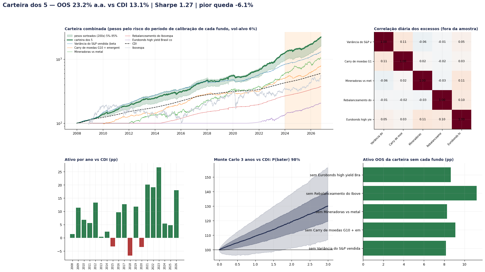
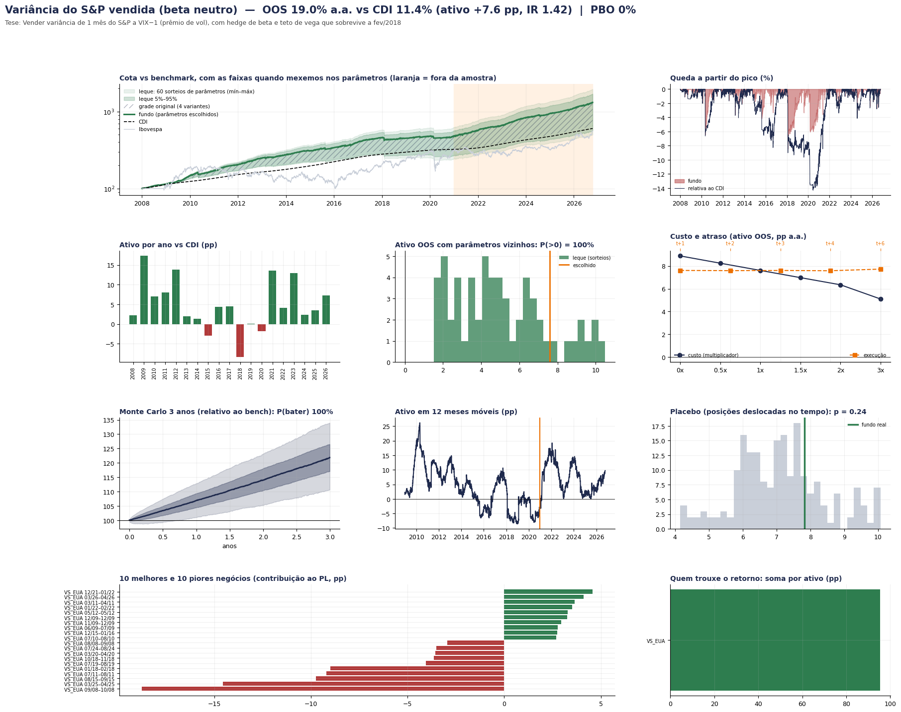
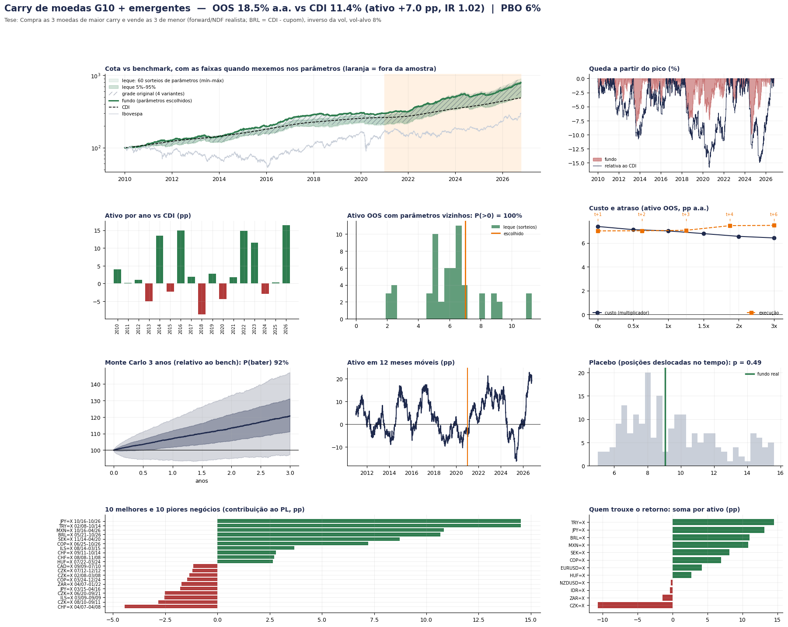
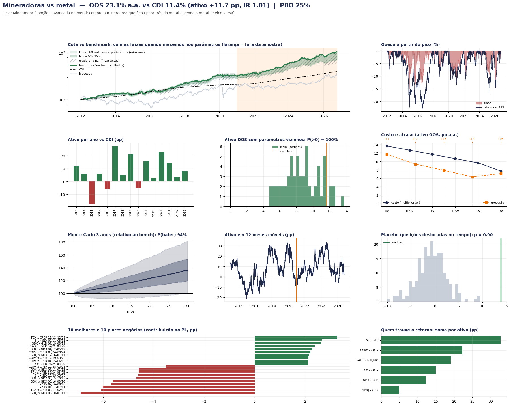
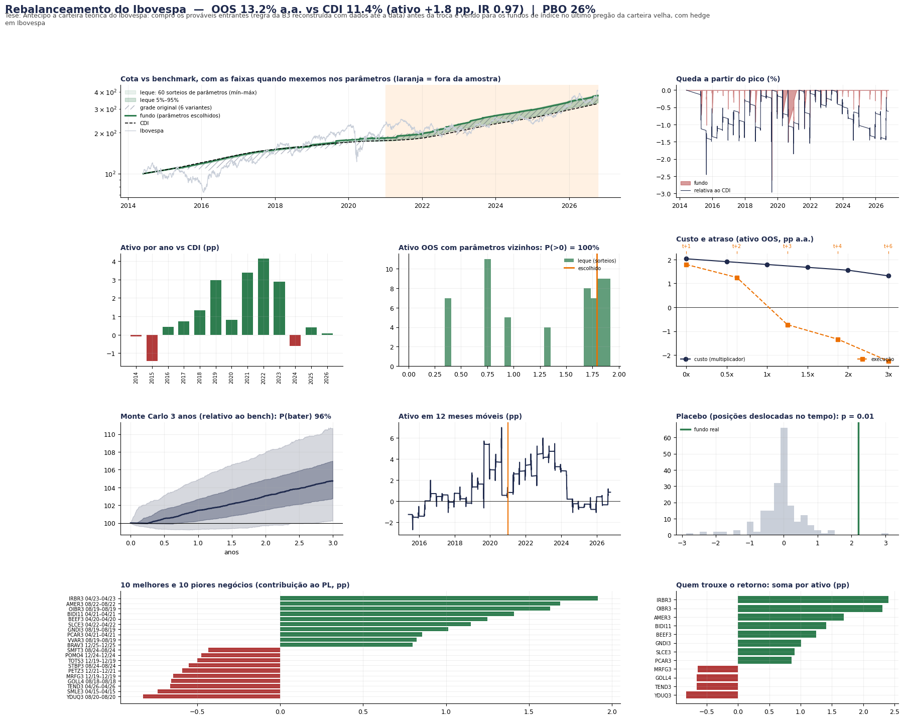
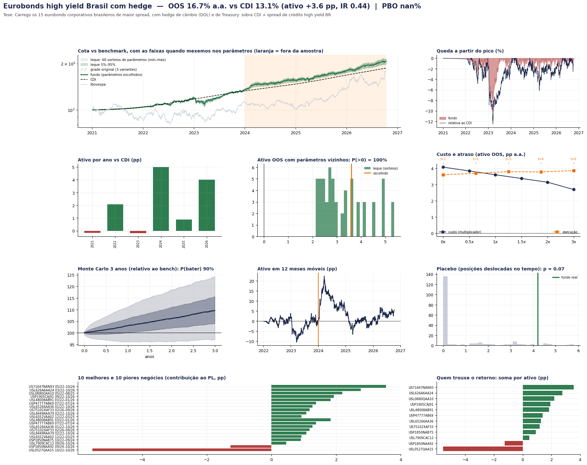

# Fundos quant — top 5 (com dados, código e robustez)

Cinco estratégias que sobreviveram a uma pesquisa com **109 estratégias** (Brasil, EUA, Europa, Ásia, fronteira; ações, juros, moedas,
crédito, commodities, opções e eventos) e a **três auditorias** de bugs e vieses. Tudo aqui roda **sem internet**: os dados já estão em
`dados/`, o código é curto e comentado, e um comando reproduz todos os números e gráficos.

> Pesquisa, não recomendação de investimento. Resultados simulados com custos estimados; o passado não garante o futuro.

## Como rodar

```bash
pip install -r requirements.txt
python rodar.py              # os 5 fundos + carteira combinada (~10–20 min)
python rodar.py --rapido     # leque de parâmetros com 20 sorteios
python rodar.py mineradoras  # um fundo só
```

Saídas em `resultados/`: um painel `.png` por fundo, `carteira.png` e uma pasta por fundo com todos os números em CSV
(métricas, ano a ano, grade, leque, custo/atraso, Monte Carlo, testes de look-ahead, negócios, contribuição por ativo, concentração,
regime, walk-forward).

## Os 5 fundos

| Fundo | Tese de mesa | Benchmark | Fora da amostra desde |
|---|---|---|---|
| Variância do S&P vendida (beta neutro) | Vender variância de 1 mês do S&P a VIX−1 (prêmio de vol), com hedge de beta e teto de vega que sobrevive a fev/2018 | CDI | 2021-01 |
| Carry de moedas G10 + emergentes | Compra as 3 moedas de maior carry e vende as 3 de menor (forward/NDF realista; BRL = CDI - cupom), inverso da vol, vol-alvo 8% | CDI | 2021-01 |
| Mineradoras vs metal | Mineradora é opção alavancada no metal: compro a mineradora que ficou para trás do metal e vendo o metal (e vice-versa) | CDI | 2021-01 |
| Rebalanceamento do Ibovespa | Antecipo a carteira teórica do Ibovespa: compro os prováveis entrantes (regra da B3 reconstruída com dados até a data) antes da troca e vendo para os fundos de índice no último pregão da carteira velha, com hedge em Ibovespa | CDI | 2021-01 |
| Eurobonds high yield Brasil com hedge | Carrego os 15 eurobonds corporativos brasileiros de maior spread, com hedge de câmbio (DOL) e de Treasury: sobra CDI + spread de crédito high yield BR | CDI | 2024-01 |

## Resultado e robustez (fora da amostra, líquido de custos; sem taxa de gestão/performance; despesas de 0,15% a.a.)

| Fundo | Retorno a.a. vs bench | Ativo pp | IR | Pior queda | PBO | Sharpe defl. grade / 109 | Leque p5 / mediana / p95 | MC P(bater 3a) | Custo 2x / exec t+3 | Walk-forward | Sem 10 melhores | Placebo p | Look-ahead |
|---|---|---|---|---|---|---|---|---|---|---|---|---|---|
| Variância do S&P vendida (beta neutro) | 19.0% vs 11.4% | **+7.6** | 1.42 | -3.6% | 0% | 51% / 20% | +1.8 / +4.5 / +9.6 | 100% | +6.3 / +7.6 | +7.6 | +2.9 | 0.24 | ✅ |
| Carry de moedas G10 + emergentes | 18.5% vs 11.4% | **+7.0** | 1.02 | -9.9% | 6% | 71% / 51% | +2.4 / +6.3 / +9.4 | 92% | +6.6 / +7.1 | +8.8 | +2.1 | 0.49 | ✅ |
| Mineradoras vs metal | 23.1% vs 11.4% | **+11.7** | 1.01 | -12.8% | 25% | 97% / 95% | +5.3 / +8.6 / +12.3 | 94% | +9.7 / +7.9 | +11.7 | +8.3 | 0.00 | ✅ |
| Rebalanceamento do Ibovespa | 13.2% vs 11.4% | **+1.8** | 0.97 | -1.1% | 26% | 90% / 81% | +0.3 / +1.7 / +1.9 | 96% | +1.6 / -0.7 | +1.8 | -0.1 | 0.01 | ✅ |
| Eurobonds high yield Brasil com hedge | 16.7% vs 13.1% | **+3.6** | 0.44 | -3.5% | n/d | 74% / 73% | +2.2 / +3.0 / +4.9 | 90% | +3.1 / +3.8 | +4.3 | +3.5 | 0.07 | ✅ |

**Como ler:**
- *ativo* = retorno acima do benchmark (pp ao ano). *IR* = ativo / tracking error.
- *PBO* = probabilidade de a escolha de parâmetros ser overfitting (CSCV, Bailey et al.). Abaixo de 30% é bom.
- *Sharpe deflacionado* = probabilidade de o IR verdadeiro ser > 0 descontando quantas coisas foram testadas — na grade do fundo e,
  mais duro, considerando as 109 estratégias da pesquisa inteira.
- *Leque* = 60 sorteios contínuos dos parâmetros ao redor dos escolhidos (ex.: janela 63 → 45–90 dias): faixa 5%–95% do ativo.
- *Monte Carlo* = bootstrap em blocos de 21 dias do excesso fora da amostra: chance de bater o benchmark em 3 anos.
- *Placebo* = as mesmas posições deslocadas no tempo; p baixo = o *timing* do sinal importa. Em estratégias que ficam sempre
  posicionadas (carry, venda de vol) o p alto é esperado: o retorno vem de estar posicionado, não do timing.
- *Walk-forward* = re-escolhe a variante da grade todo 1º de janeiro usando só o passado.
- *Sem os 10 melhores* = ativo fora da amostra tirando os 10 negócios que mais ganharam.

### Carteira combinada
Pesos pelo inverso da volatilidade de cada fundo no **seu** período de calibração, alavancada para 6% de vol (medida antes do corte).

- Fora da amostra (todos os fundos já fora da amostra): **23.2% a.a. vs CDI 13.1%**, Sharpe 1.27, pior queda -6.1%; período todo: 18.0% a.a. vs 10.1%, Sharpe 1.17, pior queda -8.7%.
- Pesos (fração do PL): variancia 0.67, carry_moedas 0.51, mineradoras 0.28, rebal_ibovespa 1.44, eurobonds 0.45
- Monte Carlo: P(bater o CDI) em 1 / 3 / 5 anos = 90% / 98% / 100%
- Ativo fora da amostra sem cada fundo (re-alavancado para 6%): Variância do S&P vendida (beta neutro) +8.2 pp; Carry de moedas G10 + emergentes +9.1 pp; Mineradoras vs metal +8.3 pp; Rebalanceamento do Ibovespa +11.2 pp; Eurobonds high yield Brasil com hedge +8.6 pp

## Painéis

Cada painel mostra: cota vs benchmark com o **leque de parâmetros** (faixas 5–95% e mín–máx) e a grade original; queda; ativo ano a ano;
distribuição do leque; custo (0–3x) e atraso (t+1 a t+6); Monte Carlo de 3 anos; ativo em 12 meses móveis; placebo; 10 melhores e
10 piores negócios; contribuição por ativo.



### Variância do S&P vendida (beta neutro)


### Carry de moedas G10 + emergentes


### Mineradoras vs metal


### Rebalanceamento do Ibovespa


### Eurobonds high yield Brasil com hedge


## Checagens de viés e look-ahead

- **Truncamento**: cada fundo é rodado com TODOS os dados apagados depois de uma data T (3 datas); o excesso até T−1 tem de ser idêntico.
  Os regimes (VIX, S&P, HYG/IEF, Ibovespa, stop) passam pelo mesmo teste com os dados comuns cortados. Resultado em
  `resultados/*/teste_lookahead_truncamento.csv` e `resultados/teste_lookahead_regimes.csv` (todos com diferença 0).
- **Execução**: decisão no fechamento de t, execução no fechamento de t+1 (+ atraso testado até t+6); regimes de mercado com sinal de t−2.
- **Sobrevivência**: ações BR do COTAHIST completo (inclui empresas em recuperação judicial e deslistadas); ETFs e índices sem esse viés;
  eurobonds com preço "vivo" e filtro de liquidez.
- **Limpezas de dado que olham o futuro** (só para corrigir erros de cotação, não para sinal), feitas na exportação e documentadas no
  topo de cada módulo: câmbio do Yahoo (erros de 100x que se desfazem em até 8 dias), CPER (prints errados em 2014–15), proventos/desdobramentos B3.
- **Premissas conhecidas** (documentadas nos módulos): carry do real antes de 2019 = Selic − Fed funds − 1,07 pp (spread medido depois de
  2019); swap de variância sintético vendido a VIX−1 (com VIX−2 a estratégia morre); hedge cambial dos eurobonds pelo dólar futuro da B3.

## O que NÃO funcionou na pesquisa (para não repetir)
Box/conversão (≈ CDI), arbitragem ADR/BDR/units/ETF com execução no dia seguinte, captura de dividendos/JCP, venda de put sem hedge de beta
(é só beta), carry agro B3 vendido, contrarian CFTC, prever juros (Brasil e EUA), ML semanal em ações, collar, recompra, lock-up, insiders e
merger arb com dados gratuitos (viés de sobrevivência), PEAD EUA/Ásia, base cripto (risco de contraparte e margem zeram o alfa).

## Estrutura

```
comum.py        CDI, calendário, carteira (execução t+1), vol-alvo, regimes, métricas
robustez.py     toda a bateria de robustez (genérica para qualquer fundo)
graficos.py     painéis
rodar.py        roda tudo e imprime
fundos/         um arquivo por fundo (tese, parâmetros, sinal, negócios)
dados/          dados prontos (fontes públicas: B3, BCB, Yahoo Finance, CBOE, FINRA/TradingView, BIS)
resultados/     saídas
CONTRATO_FUNDO.md  como escrever um fundo novo que roda na mesma bateria
```

Fontes dos dados: B3 (COTAHIST, ajustes de futuros), Banco Central (SGS), BIS (juros de política), Yahoo Finance (ETFs, índices, câmbio),
CBOE (VIX), FINRA/TradingView (preços de eurobonds). Verifique os termos de uso de cada fonte antes de redistribuir.
