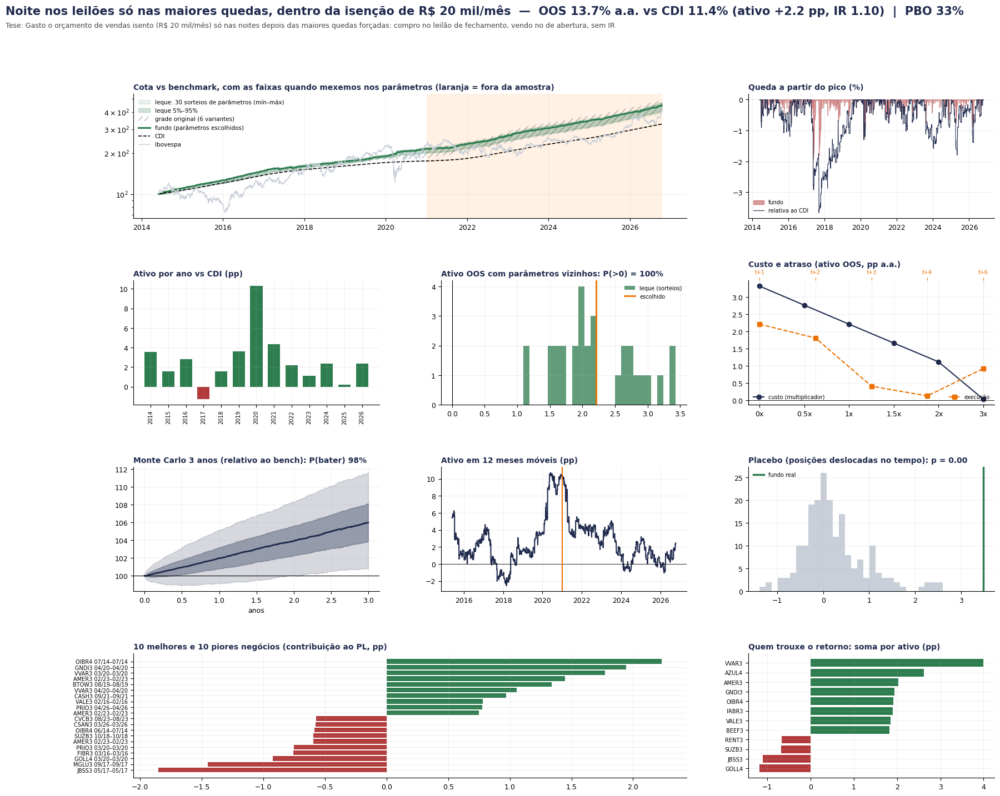

# Rodada pessoa física: R$ 20–50 mil, todas as contas como um fundo

Um grupo com R$ 20 a 50 mil opera como UM fundo em todas as contas de pessoa física (IBKR, Clear, Rico, XP, Tesouro Direto,
plataformas de renda fixa). **Caixa sempre em R$ no CDI** (inclusive a garantia na B3); na IBKR fica só a margem necessária.
Contratos e ações inteiros, custos e aluguel de varejo, IR por classe (benchmark: CDI e CDI depois de 15% de IR).
Motor: [`pf.py`](pf.py) · regras das frentes: [`BRIEF_PF.md`](BRIEF_PF.md) · executor: [`rodar_pf.py`](rodar_pf.py).

```bash
python pf/rodar_pf.py top5 bb_dividendo_extra_aud mx_noite_isenta b3_opa_leilao b3_ofertas_varejo_aud rev_rebal_ibovespa# usa as baterias salvas
python pf/rodar_pf.py um b3_leilao_noite_aud     # refaz a bateria completa de um fundo (os dados do top 5 estão no repositório)
```

## O que foi testado
**148 estratégias** de pessoa física (3 rodadas): as 39 que tiveram alfa na pesquisa institucional (revisitadas com R$ 20–50 mil) e ~40 novas, em
6 frentes (ações B3 e eventos; renda fixa PF; derivativos B3 com garantia em Tesouro Selic; micro futuros CME com só a margem fora;
global via B3 e cripto; macro e ações com hedge). 27 bateram o CDI depois do IR antes da auditoria. Ranking completo:
[`resultados/ranking_pf.csv`](resultados/ranking_pf.csv). Cadernos: [`pesquisa/`](pesquisa/).

## Auditoria ([`pesquisa/auditoria_pf.md`](pesquisa/auditoria_pf.md))
Os três primeiros do ranking caíram:
| Fundo | Por quê |
|---|---|
| Covered call em ações isentas (+11,8 pp) | era carteira de 3 ações (beta); as calls sozinhas perdem 1,8 pp a.a. |
| BDR x EUA com ordem limitada (+12,5 pp) | 94% do ganho vinha de fills "quando a mínima encostou no limite" (seleção adversa); conservador: −12,6 pp |
| VXM vendido (+19,8 pp) | em mar/2020 1 VXM perdeu ~R$ 31 mil (> R$ 20 mil): a IBKR liquidaria no pico |
| Carry PF micro FX + WDO (+11,4 pp) | o grosso era a perna do real (WDO); só G10: +1,2 pp depois do IR |
| WDO vendido (carry do real) | com R$ 20 mil = 2,6x alavancado (−57 pp em 2024); com R$ 50 mil é **beta de carry do real** (+7,1 pp depois do IR), não alfa |
| PEAD B3 em lote pequeno | sem os 10 melhores negócios: −3,8 pp; ponta vendida perde |
| Spin-offs com hedge, small caps valor | reprovados no teste de look-ahead (truncamento) |

## Top 5 final (148 estratégias PF, 3 rodadas, 3 auditorias) — fora da amostra desde 2021, pp a.a. sobre o CDI

Critério: **maior chance de funcionar fora da amostra**: passa no look-ahead, aprovado/sem falha na auditoria, aguenta custo 2x e execução
t+2, placebo significativo, PBO baixo, IR alto. IR de pessoa física por `ir.py` (B3 mensal com isenção de ações ≤ R$ 20 mil/mês somando
todos os fundos do CPF; exterior anual; hedge na B3 mensal).

| # | Fundo | Quem é o vendedor/comprador forçado | R$ 20 mil antes / depois do IR | R$ 50 mil depois do IR | IR | PBO | P(bater 3a) | Custo 2x | Sem os 10 melhores |
|---|---|---|---|---|---|---|---|---|---|
| 1 | Dividendo/JCP extraordinário até a data-com | o investidor de renda TEM de comprar até a data-com | +17,6 / **+14,4** (conservador +8,3) | +15,5 | 1,25 | 0% | 99% | +11,4 | +10,3 |
| 2 | Noite nos leilões, só as maiores quedas, dentro da isenção de R$ 20 mil/mês | quem vende no pânico do leilão de fechamento paga a liquidez | +2,2 / +2,2 | +0,8 | 1,10 | 33% | 98% | +1,1 | +0,9 |
| 3 | OPA até o leilão (lote pequeno) | o institucional não entra pelo tamanho | +4,1 / +4,0 | +4,0 | 0,54 | 36% | 88% | +4,0 | −2,2 |
| 4 | Ofertas pela tranche de varejo | desconto de lançamento (rateio 15%) | +2,6 / +2,5 | +2,5 | 0,56 | 41% | 86% | +2,5 | −1,2 |
| 5 | Rebalanceamento do Ibovespa | o fundo de índice tem de comprar | +1,0 / +1,0 | +1,1 | 0,42 | 13% | 80% | +0,5 | −0,7 |

6º (reserva): petróleo em pânico (+2,9 depois do IR; placebo p = 0,14). Satélites frágeis: noite dos leilões sem limite (+5,7, custo 2x −9,8) e
spread do milho (+7,6, 9 safras). O nº 2 veio da transferência de mecanismos: aplicar o "ser pequeno" (limite de isenção como teto de giro)
ao leilão tornou o edge menor porém robusto. Com R$ 50 mil o nº 2 rende menos porque a isenção é por CPF (dois CPFs resolveriam).

### Carteira com os 5 (pesos pelo risco de cada fundo antes do corte; tudo em conta B3 + Tesouro Selic, sem remessa)
| Capital | Alavancagem | OOS a.a. | CDI | Ativo | **Depois do IR** | Sharpe | Pior queda |
|---|---|---|---|---|---|---|---|
| R$ 20 mil | 1x | 16,4% | 11,4% | +4,9 pp | **+4,3 pp** | 1,44 | −2,1% |
| R$ 20 mil | 2x | 16,5% | 11,4% | +5,1 pp | +4,4 pp | 1,45 | −2,1% |
| R$ 50 mil | 1x | 14,3% | 11,4% | +2,9 pp | +2,5 pp | 1,29 | −1,3% |
| R$ 50 mil | 2x | 14,5% | 11,4% | +3,0 pp | +2,6 pp | 1,31 | −1,3% |

Monte Carlo (R$ 20 mil): 96% / 99,9% / 100% de chance de bater o CDI em 1 / 3 / 5 anos. Sem cada fundo: +3,2 a +7,4 pp. Pesos com R$ 20 mil:
≈ R$ 10,4 mil ofertas, R$ 4,0 mil noite isenta, R$ 3,4 mil Ibovespa, R$ 1,4 mil dividendos, R$ 0,8 mil OPA. A alavancagem quase não ajuda:
os fundos ficam a maior parte do tempo em caixa (eventos), então o gargalo é a quantidade de eventos, não o capital.

### E o dinheiro em dólar? (rodada PF3, conta em dólar v2: T-bill + IOF só na ida + hedge em mini-dólar)
Com R$ 20–50 mil **o melhor é deixar R$ 0 em dólar**. Só manter o caixa lá fora custa −2,3/−4,5/−6,8 pp a.a. do fundo (R$ 5/10/15 mil fora de
R$ 20 mil), porque o hedge em WDO (US$ 10 mil por contrato) arredonda para zero abaixo de ~R$ 27 mil fora, e sem hedge o caixa rende T-bill
em vez de CDI. Nenhuma estratégia internacional (pânico de país, Argentina, Russell, spin-offs, noite nos EUA, mineradoras, variância, crédito EM,
carry G10, Euro Stoxx) paga isso; com R$ 50 mil + 1 WDO os números ficam positivos só por sobre-hedge (aposta vendida em dólar). O hedge correto
começa em ~R$ 55 mil fora (custo ≈ −0,5 pp a.a.). Detalhe: `pesquisa/pf3_internacional_A.md` e `_B.md`.

### Transferência de mecanismos (`pesquisa/pf3_mecanismos.md`)
Só "ser pequeno" se transferiu (noite isenta). Calendário sem surpresa (JCP de dezembro, data-com de FII, vencimento) já está no preço; a âncora
precisa ser um preço que alguém paga no mesmo horário (VP de FII e ADR em outro fuso não servem); magnitude vale para o tamanho do fluxo forçado,
não do desconto (OPA com desconto maior = mais risco do negócio; follow-on grande = recapitalização que salva a empresa).

### Não é alfa (beta), mas existe para quem quiser risco
Carry do real vendendo mini-dólar com R$ 50 mil (+7,4 pp depois do IR, quedas de 30%+), S&P via mini da B3 (+4,1 pp), ouro com micro
futuro (+4,3 pp), cripto (+2 a +4 pp). Rendem acima do CDI por estarem expostos a um mercado que subiu, não por habilidade.

### O que as auditorias derrubaram
Covered call isenta (era carteira de ações), BDR com ordem limitada (fills impossíveis), VXM vendido (quebra em mar/2020), carry PF
(era a perna do real), PEAD (some sem os 10 melhores), fracionário x lote (pernas não simultâneas), cripto/S&P/ouro/tendência (beta).
Detalhe em `pesquisa/auditoria_pf.md` e `pesquisa/correcoes_finais.md`; ranking completo com o veredito em `resultados/ranking_pf.csv`.

## Painéis





## Limitações
- IR simplificado em dois pontos: o CDI de uma parcela aplicada em ativo isento paga 15% (conservador) e a renda fixa usa 15% fixo
  (tabela regressiva de 22,5% para prazos curtos não aplicada). A isenção de R$ 20 mil é por CPF: com amigos em vários CPFs ela seria maior.
- As vendas de ações para a isenção vêm dos pesos-alvo (aproximação).
- O título da figura da carteira menciona "vol-alvo 6%" por herança do gráfico institucional; a carteira PF não tem vol-alvo.
