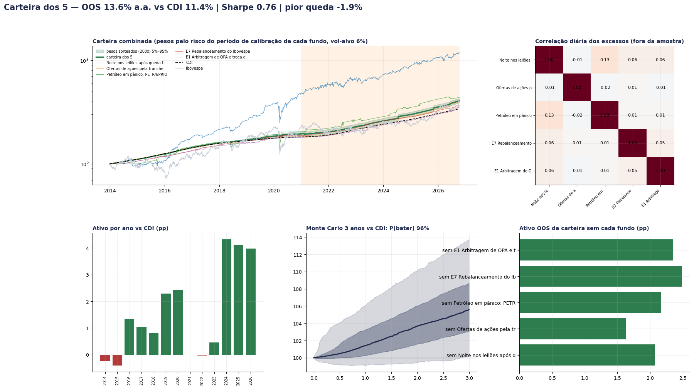
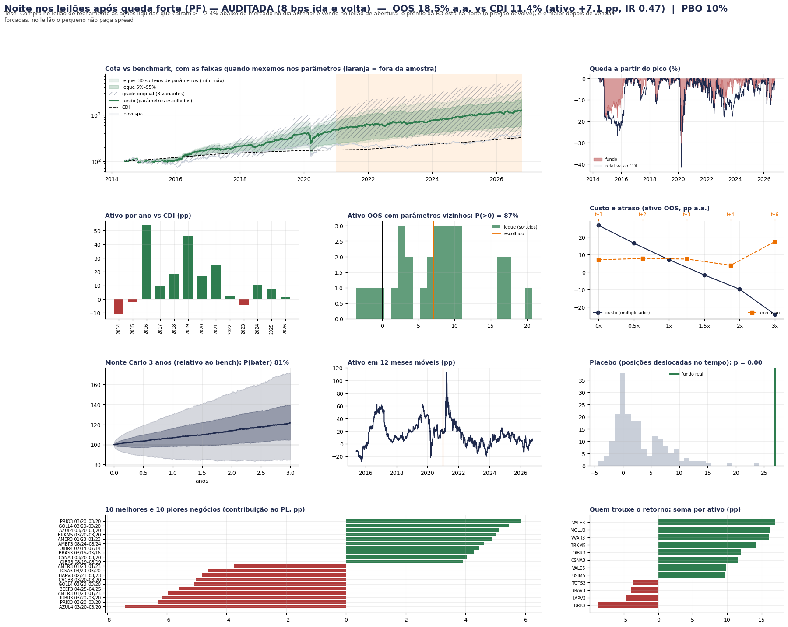
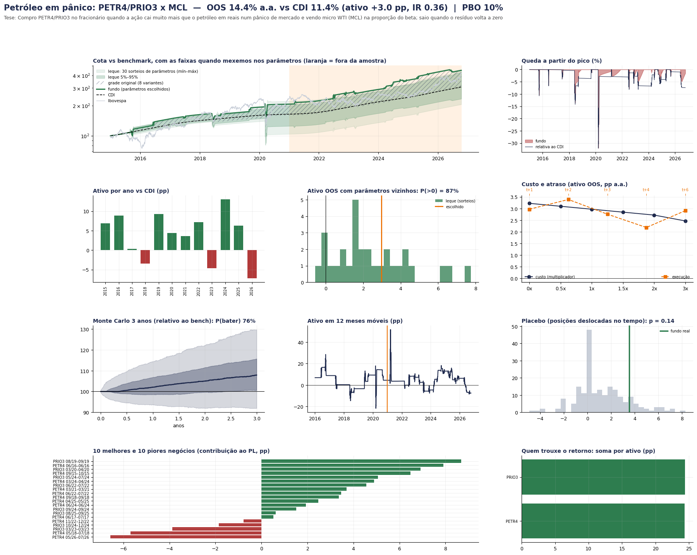
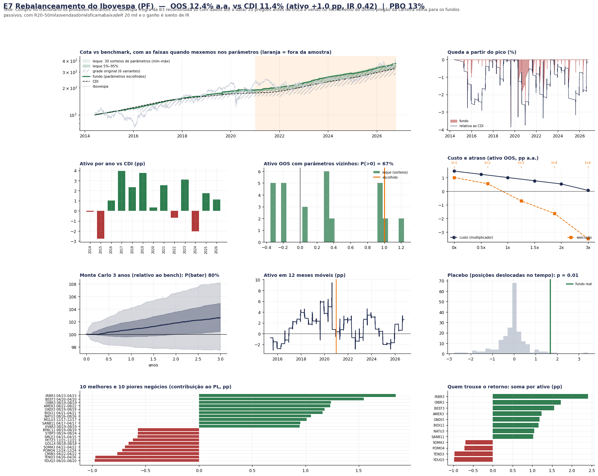
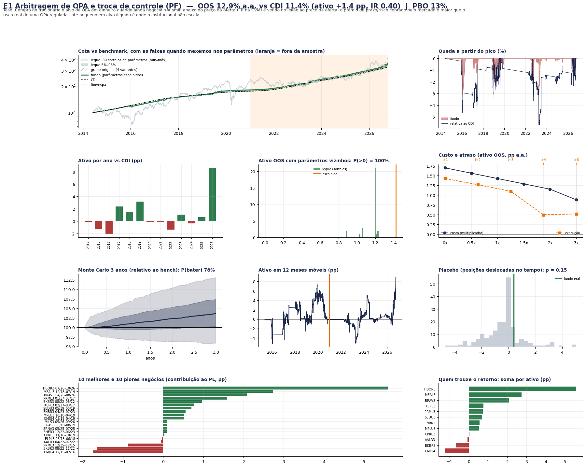

# Rodada pessoa física: R$ 20–50 mil, todas as contas como um fundo

Um grupo com R$ 20 a 50 mil opera como UM fundo em todas as contas de pessoa física (IBKR, Clear, Rico, XP, Tesouro Direto,
plataformas de renda fixa). **Caixa sempre em R$ no CDI** (inclusive a garantia na B3); na IBKR fica só a margem necessária.
Contratos e ações inteiros, custos e aluguel de varejo, IR por classe (benchmark: CDI e CDI depois de 15% de IR).
Motor: [`pf.py`](pf.py) · regras das frentes: [`BRIEF_PF.md`](BRIEF_PF.md) · executor: [`rodar_pf.py`](rodar_pf.py).

```bash
python pf/rodar_pf.py top5 b3_leilao_noite_aud b3_ofertas_varejo_aud mh_petroleo rev_rebal_ibovespa rev_opa   # usa as baterias salvas
python pf/rodar_pf.py um b3_leilao_noite_aud     # refaz a bateria completa de um fundo (os dados do top 5 estão no repositório)
```

## O que foi testado
**52 estratégias** de pessoa física: as 39 que tiveram alfa na pesquisa institucional (revisitadas com R$ 20–50 mil) e ~40 novas, em
6 frentes (ações B3 e eventos; renda fixa PF; derivativos B3 com garantia em Tesouro Selic; micro futuros CME com só a margem fora;
global via B3 e cripto; macro e ações com hedge). 27 bateram o CDI depois do IR antes da auditoria. Ranking completo:
[`resultados/ranking_pf.csv`](resultados/ranking_pf.csv). Cadernos: [`pesquisa/`](pesquisa/).

## Auditoria ([`pesquisa/auditoria_pf.md`](pesquisa/auditoria_pf.md))
Os três primeiros do ranking caíram:
| Fundo | Por quê |
|---|---|
| Covered call em ações isentas (+11,8 pp) | era carteira de 3 ações (beta); as calls sozinhas perdem 1,8 pp a.a. |
| BDR x EUA com ordem limitada (+12,5 pp) | 94% do ganho vinha de fills "quando a mínima encostou no limite" (seleção adversa); conservador: −12,6 pp |
| VXM vendido (+19,8 pp) | em mar/2020 1 VXM perdeu ~R$ 31 mil (> R$ 20 mil): a IBKR liquidaria no pico |
| Carry PF micro FX + WDO (+11,4 pp) | o grosso era a perna do real (WDO); só G10: +1,2 pp depois do IR |
| WDO vendido (carry do real) | com R$ 20 mil = 2,6x alavancado (−57 pp em 2024); com R$ 50 mil é **beta de carry do real** (+7,1 pp depois do IR), não alfa |
| PEAD B3 em lote pequeno | sem os 10 melhores negócios: −3,8 pp; ponta vendida perde |
| Spin-offs com hedge, small caps valor | reprovados no teste de look-ahead (truncamento) |

## Top 5 (pós-auditoria) — fora da amostra desde 2021, pp a.a. sobre o CDI

| # | Fundo | Tese de mesa | R$ 20 mil (antes / depois do IR) | R$ 50 mil (depois do IR) | IR | PBO | Ressalva |
|---|---|---|---|---|---|---|---|
| 1 | Noite nos leilões após queda forte | compra no leilão de fechamento ações líquidas que caíram forte no dia e vende no leilão de abertura (quem vende no pânico do fim do dia paga a liquidez) | **+7,1 / +5,6** | +5,6 | 0,47 | 10% | muito sensível a custo: cada 1 bp por lado ≈ 2,3 pp a.a.; com 12 bps fica negativo |
| 2 | Ofertas de ações pela tranche de varejo | pedir na oferta (follow-on/IPO) com o desconto de lançamento e vender em poucos dias (rateio de 15%, pedido bloqueado) | +2,6 / +2,1 | +2,1 | 0,56 | 41% | 3 ofertas dão ~15 de 23 pp |
| 3 | Petróleo em pânico (PETR4/PRIO3 x petróleo) | comprar a petroleira quando cai muito mais que o Brent em R$ (vendedor forçado) e sair quando reconverge | +3,0 / +2,2 | +3,0 | 0,36 | 10% | 22 negócios em 12 anos; perde em pânico de governança |
| 4 | Rebalanceamento do Ibovespa | comprar os prováveis entrantes antes do fundo de índice | +1,0 / +0,8 | +1,0 | 0,42 | 13% | pequeno, concentrado em poucos eventos |
| 5 | Arbitragem de OPA | comprar abaixo do preço da oferta e receber no leilão | +1,4 / +1,2 | +1,2 | 0,40 | 13% | após auditoria ≈ +0,5 pp (HBOR3 dominava) |

Opcional com R$ 50 mil: **carry do real em WDO** (+7,1 pp depois do IR), mas é beta de "comprado em real", com quedas de 30%+.

### Carteira (pesos pelo risco de cada fundo antes do corte; todos operáveis com R$ 20 mil)
| Capital | Alavancagem | OOS a.a. | CDI | Ativo | Depois do IR | Sharpe | Pior queda |
|---|---|---|---|---|---|---|---|
| R$ 20 mil | 1x | 13,6% | 11,4% | **+2,2 pp** | **+1,8 pp** | 0,76 | −1,9% |
| R$ 20 mil | 2x | 14,4% | 11,4% | +3,0 pp | +2,5 pp | 0,89 | −3,7% |
| R$ 50 mil | 1x | 13,7% | 11,4% | +2,3 pp | +1,9 pp | 0,78 | −1,9% |
| R$ 50 mil | 2x | 14,6% | 11,4% | +3,1 pp | +2,6 pp | 0,92 | −4,0% |

Monte Carlo: 96% de chance de bater o CDI em 3 anos (R$ 20 mil, 1x). Nenhum cenário quebrou. Os 5 têm correlação ≈ 0 entre si.
Detalhe: [`resultados/carteira_pf.csv`](resultados/carteira_pf.csv).

**Leitura honesta:** com R$ 20–50 mil o alfa realista é de **+2 a +3 pp a.a. sobre o CDI depois do IR**, vindo de edges brasileiros de
tamanho pequeno (leilão, ofertas de varejo, pânico em petroleira, índice, OPA). As estratégias globais/derivativos que geravam +7 a +12 pp
no institucional não sobrevivem ao tamanho do contrato, ao câmbio, ou eram beta/cauda.

## Painéis







## Limitações desta rodada
- 4 estratégias não concluíram por erro de dados nas frentes (fracionário x lote padrão, OPA em leilão de small caps, units, prêmio de
  ETFs de cripto) e 2 de micro futuros (cripto e juros do Fed) ficaram fora do executor final (resultados das frentes: −1,0 e −2,1 pp).
- Três frentes (renda fixa, ações B3, global/cripto) foram interrompidas antes de escrever o caderno; seus fundos entraram no ranking
  normalmente. O IR foi aplicado com uma regra única e conservadora (15% sobre o ganho além do CDI; 0% nas classes isentas).
- O painel de cada fundo diz "vol-alvo 6%" no título da carteira por herança do gráfico institucional; a carteira PF NÃO tem vol-alvo.
