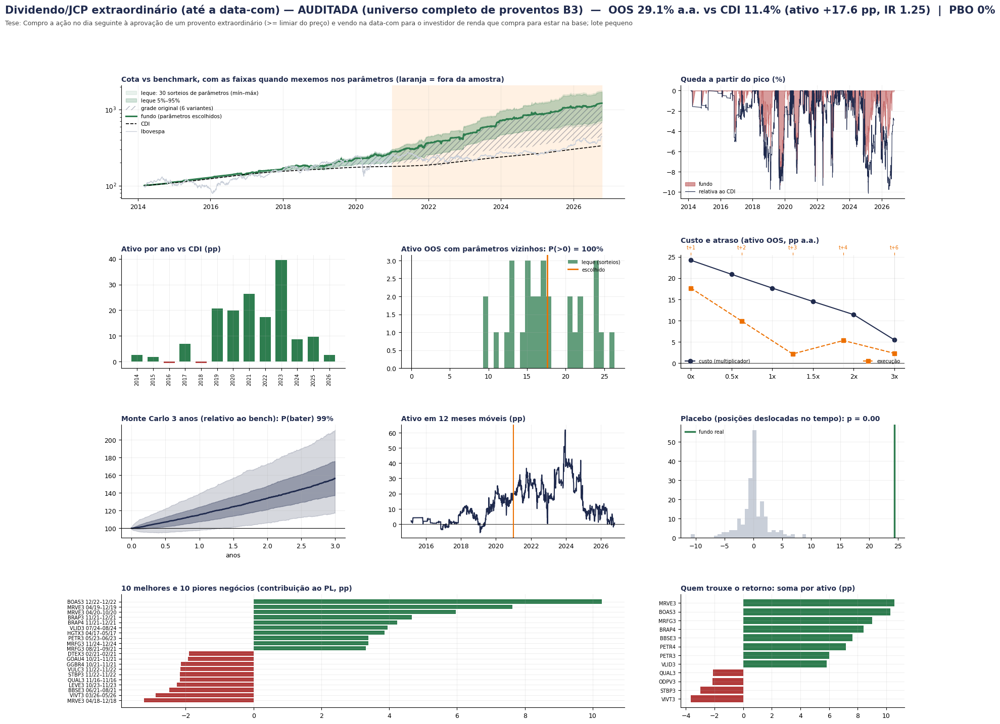
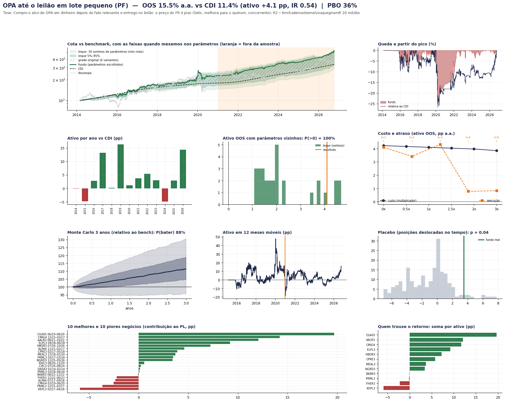
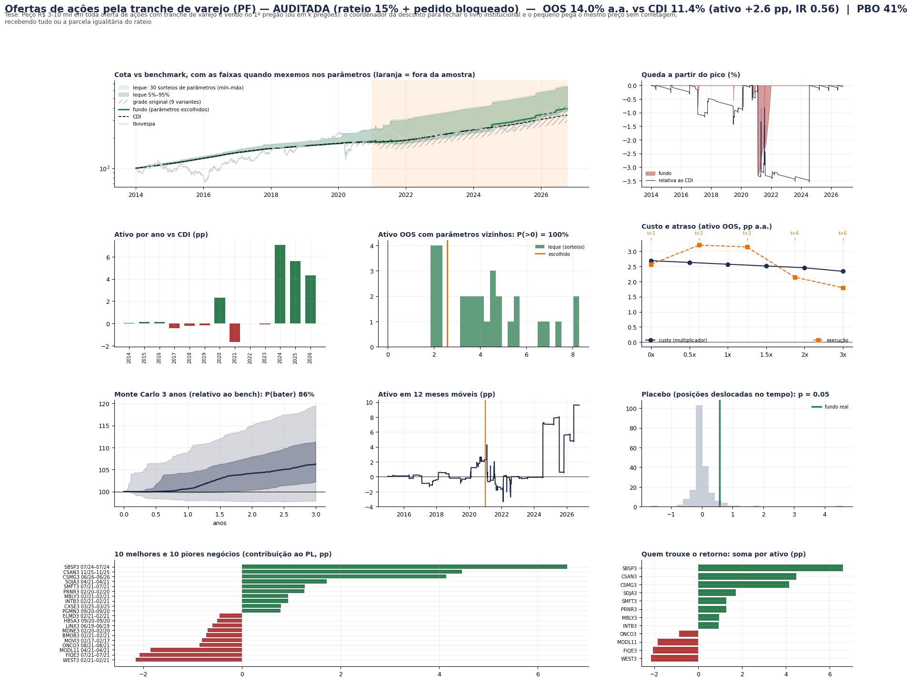

# Rodada pessoa física: R$ 20–50 mil, todas as contas como um fundo

Um grupo com R$ 20 a 50 mil opera como UM fundo em todas as contas de pessoa física (IBKR, Clear, Rico, XP, Tesouro Direto,
plataformas de renda fixa). **Caixa sempre em R$ no CDI** (inclusive a garantia na B3); na IBKR fica só a margem necessária.
Contratos e ações inteiros, custos e aluguel de varejo, IR por classe (benchmark: CDI e CDI depois de 15% de IR).
Motor: [`pf.py`](pf.py) · regras das frentes: [`BRIEF_PF.md`](BRIEF_PF.md) · executor: [`rodar_pf.py`](rodar_pf.py).

```bash
python pf/rodar_pf.py top5 bb_dividendo_extra_aud b3_opa_leilao mh_petroleo b3_ofertas_varejo_aud rev_rebal_ibovespa   # usa as baterias salvas
python pf/rodar_pf.py um b3_leilao_noite_aud     # refaz a bateria completa de um fundo (os dados do top 5 estão no repositório)
```

## O que foi testado
**126 estratégias** de pessoa física (2 rodadas): as 39 que tiveram alfa na pesquisa institucional (revisitadas com R$ 20–50 mil) e ~40 novas, em
6 frentes (ações B3 e eventos; renda fixa PF; derivativos B3 com garantia em Tesouro Selic; micro futuros CME com só a margem fora;
global via B3 e cripto; macro e ações com hedge). 27 bateram o CDI depois do IR antes da auditoria. Ranking completo:
[`resultados/ranking_pf.csv`](resultados/ranking_pf.csv). Cadernos: [`pesquisa/`](pesquisa/).

## Auditoria ([`pesquisa/auditoria_pf.md`](pesquisa/auditoria_pf.md))
Os três primeiros do ranking caíram:
| Fundo | Por quê |
|---|---|
| Covered call em ações isentas (+11,8 pp) | era carteira de 3 ações (beta); as calls sozinhas perdem 1,8 pp a.a. |
| BDR x EUA com ordem limitada (+12,5 pp) | 94% do ganho vinha de fills "quando a mínima encostou no limite" (seleção adversa); conservador: −12,6 pp |
| VXM vendido (+19,8 pp) | em mar/2020 1 VXM perdeu ~R$ 31 mil (> R$ 20 mil): a IBKR liquidaria no pico |
| Carry PF micro FX + WDO (+11,4 pp) | o grosso era a perna do real (WDO); só G10: +1,2 pp depois do IR |
| WDO vendido (carry do real) | com R$ 20 mil = 2,6x alavancado (−57 pp em 2024); com R$ 50 mil é **beta de carry do real** (+7,1 pp depois do IR), não alfa |
| PEAD B3 em lote pequeno | sem os 10 melhores negócios: −3,8 pp; ponta vendida perde |
| Spin-offs com hedge, small caps valor | reprovados no teste de look-ahead (truncamento) |

## Top 5 final (126 estratégias PF testadas, 2 rodadas, 3 auditorias) — fora da amostra desde 2021, pp a.a. sobre o CDI

Critério: **maior chance de funcionar fora da amostra** (não o maior retorno): passa no look-ahead, aprovado na auditoria, aguenta custo 2x e
execução t+2, placebo significativo, PBO baixo. IR de pessoa física por `ir.py` (B3 mensal com isenção de ações ≤ R$ 20 mil/mês; exterior anual).

| # | Fundo | Tese de mesa (quem é o vendedor/comprador forçado) | R$ 20 mil antes / depois do IR | R$ 50 mil depois do IR | IR | PBO | Custo 2x | Sem os 10 melhores |
|---|---|---|---|---|---|---|---|---|
| 1 | Dividendo/JCP extraordinário até a data-com | o investidor de renda TEM de comprar até a data-com; a PF compra no aviso (entrega na CVM) e vende para ele no fechamento da data-com | +17,6 / **+14,4** (conservador: +10,1 / +8,3) | +15,5 | 1,25 | 0% | +11,4 | +10,4 |
| 2 | OPA até o leilão (lote pequeno) | small cap abaixo do preço da OPA/fechamento de capital; o institucional não entra pelo tamanho; vendas isentas | +4,1 / +4,0 | +4,0 | 0,54 | 36% | +4,0 | −2,3 |
| 3 | Petróleo em pânico (PETR4/PRIO3 x Brent) | a petroleira cai muito mais que o petróleo por venda forçada e reconverge | +3,0 / +2,9 | +3,4 | 0,36 | 10% | +2,7 | −2,4 |
| 4 | Ofertas de ações pela tranche de varejo | desconto de lançamento, rateio de 15% e pedido bloqueado | +2,6 / +2,5 | +2,5 | 0,56 | 41% | +2,5 | −1,3 |
| 5 | Rebalanceamento do Ibovespa | o fundo de índice tem de comprar os entrantes | +1,0 / +1,0 | +1,2 | 0,42 | 13% | +0,5 | −0,7 |

Satélites (passaram, mas frágeis): **leilão da noite após queda forte** (+5,7 pp depois do IR, mas custo 2x = −9,8) e **spread do milho na B3**
(vendido set x comprado mar, +7,6 pp com R$ 20 mil, só 9 safras, lado oposto à tese inicial, walk-forward −1,9).

Sobre o nº 1: a versão auditada usa o universo COMPLETO de proventos da B3 (inclui deslistadas, que rendem igual ou mais) e exige liquidez
≥ R$ 5 mi/dia — corte escolhido depois de ver os dados, por isso **planeje com o conservador (+8 a +9 pp depois do IR)**. O ganho vem caindo
(2023 +30,7; 2024 +8,5; 2025 +8,8). Vender no fechamento da data-com NÃO dá direito ao provento (o código não credita).

### Carteira com os 5 (pesos pelo risco de cada fundo antes do corte; tudo em conta B3 + Tesouro Selic, sem remessa)
| Capital | Alavancagem | OOS a.a. | CDI | Ativo | **Depois do IR** | Sharpe | Pior queda |
|---|---|---|---|---|---|---|---|
| R$ 20 mil | 1x | 14,6% | 11,4% | +3,2 pp | **+3,1 pp** | 0,98 | −2,2% |
| R$ 20 mil | 2x | 15,0% | 11,4% | +3,5 pp | +3,5 pp | 1,02 | −3,1% |
| R$ 50 mil | 1x | 14,8% | 11,4% | +3,3 pp | +3,3 pp | 1,01 | −2,2% |
| R$ 50 mil | 2x | 15,2% | 11,4% | +3,7 pp | +3,7 pp | 1,07 | −3,6% |

Monte Carlo (R$ 20 mil, 1x): 91% / 99% / 99,9% de chance de bater o CDI em 1 / 3 / 5 anos. Sem cada fundo: +2,3 a +4,1 pp (nenhum carrega
sozinho). Pesos com R$ 20 mil: ≈ R$ 12,6 mil ofertas, R$ 4,0 mil Ibovespa, R$ 1,6 mil dividendos, R$ 1,0 mil OPA, R$ 0,8 mil petróleo
(pelo risco medido antes de 2021; dar mais peso ao nº 1 aumenta o retorno, mas seria escolher olhando o fora da amostra).

### Não é alfa (beta), mas existe para quem quiser risco
Carry do real vendendo mini-dólar com R$ 50 mil (+7,4 pp depois do IR, quedas de 30%+), S&P via mini da B3 (+4,1 pp), ouro com micro
futuro (+4,3 pp), cripto (+2 a +4 pp). Rendem acima do CDI por estarem expostos a um mercado que subiu, não por habilidade.

### O que as auditorias derrubaram
Covered call isenta (era carteira de ações), BDR com ordem limitada (fills impossíveis), VXM vendido (quebra em mar/2020), carry PF
(era a perna do real), PEAD (some sem os 10 melhores), fracionário x lote (pernas não simultâneas), cripto/S&P/ouro/tendência (beta).
Detalhe em `pesquisa/auditoria_pf.md` e `pesquisa/correcoes_finais.md`; ranking completo com o veredito em `resultados/ranking_pf.csv`.

## Painéis







## Limitações
- IR simplificado em dois pontos: o CDI de uma parcela aplicada em ativo isento paga 15% (conservador) e a renda fixa usa 15% fixo
  (tabela regressiva de 22,5% para prazos curtos não aplicada). A isenção de R$ 20 mil é por CPF: com amigos em vários CPFs ela seria maior.
- As vendas de ações para a isenção vêm dos pesos-alvo (aproximação).
- O título da figura da carteira menciona "vol-alvo 6%" por herança do gráfico institucional; a carteira PF não tem vol-alvo.
