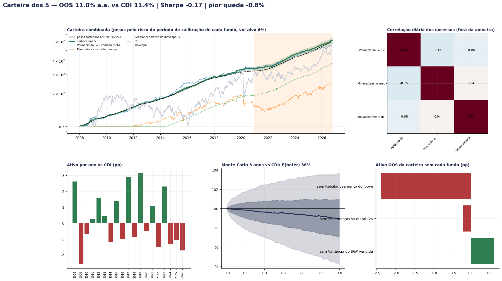
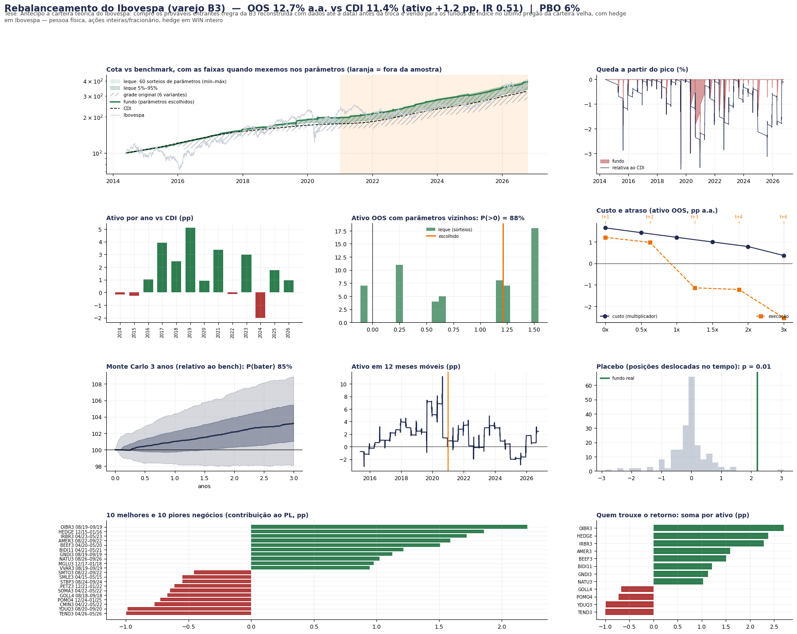
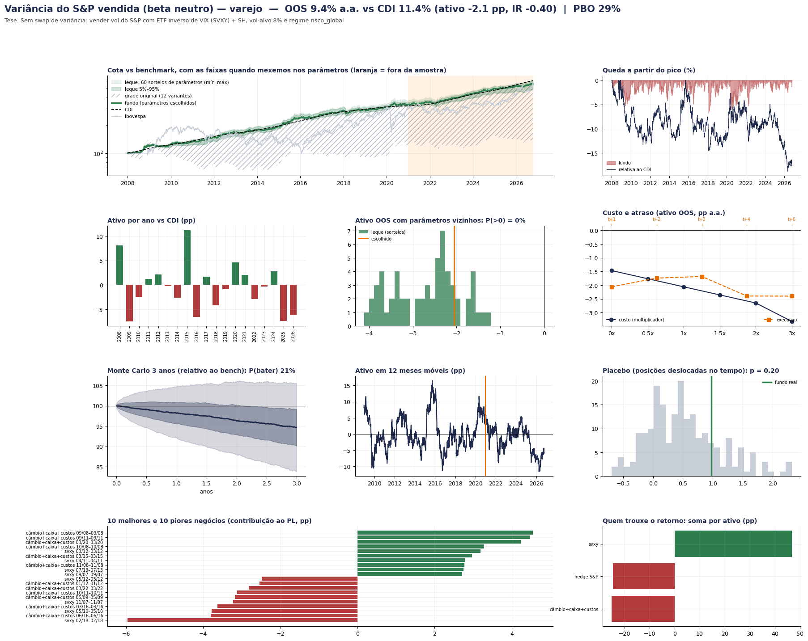
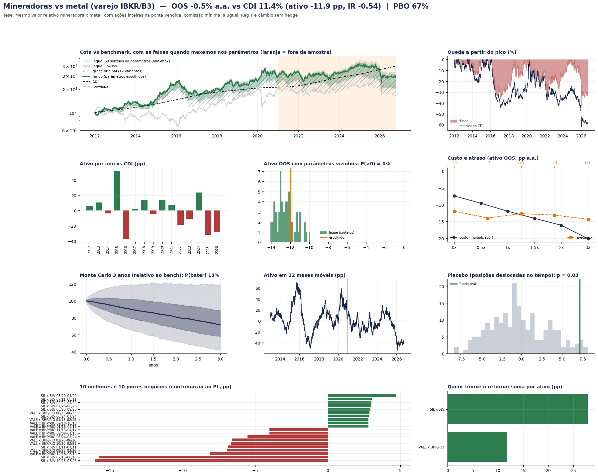
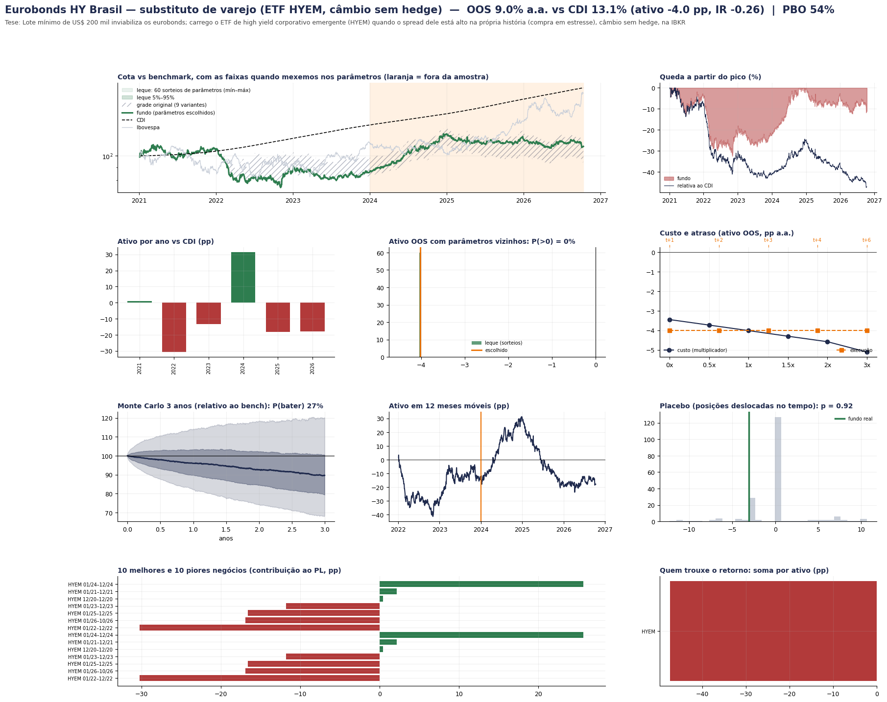
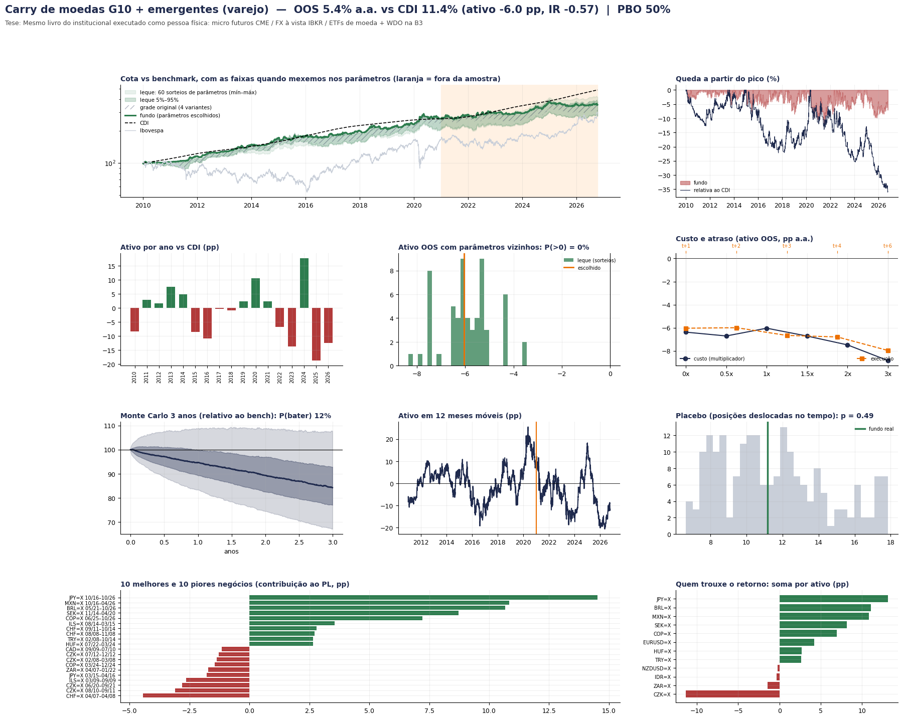

# Versão pessoa física com R$ 20 mil

Pergunta: dá para replicar os 5 fundos com R$ 20 mil em IBKR, Clear, Rico e outras corretoras de varejo? Para cada fundo,
buscamos o instrumento real de varejo (ou o substituto mais próximo), simulamos com os custos, lotes, margens e impostos de pessoa
física e passamos pela mesma bateria de robustez do institucional.

```bash
python varejo/rodar_varejo.py            # os 5 fundos de varejo + carteira de R$ 20 mil + alavancagem (~20–40 min)
python varejo/rodar_varejo.py --rapido
```

Mapa ativo por ativo (corretora, ticker, lote mínimo, custo, venda a descoberto, alavancagem, se preserva o edge, fontes):
[`MAPA_ATIVOS_EUA.md`](MAPA_ATIVOS_EUA.md) / [`mapa_ativos_eua.csv`](mapa_ativos_eua.csv) e
[`MAPA_ATIVOS_FX_B3.md`](MAPA_ATIVOS_FX_B3.md) / [`mapa_ativos_fx_b3.csv`](mapa_ativos_fx_b3.csv).
Premissas de custo e imposto: [`varejo.py`](varejo.py) (cada fundo anota onde usou um valor diferente, com fonte).

## Resultado (fora da amostra, desde 2021; eurobonds desde 2024)

| Fundo | Dá para fazer com R$ 20 mil? | Como | Ativo vs CDI antes do IR | Depois do IR (vs CDI líquido) | Institucional |
|---|---|---|---|---|---|
| Rebalanceamento do Ibovespa | **Sim** | Clear/Rico/Inter, ~4 ações no fracionário, resto em Tesouro Selic, sem hedge | **+1,2 pp** (R$ 4 mil: +1,0) | **+1,0 pp** | +1,8 pp |
| Variância do S&P | Opera, mas o edge não vem junto | SVXY + SH na IBKR (VXM e opções XSP não cabem) | −2,1 pp | −1,8 pp | +7,6 pp |
| Mineradoras vs metal | Opera, mas perde | IBKR (pares, venda em ações inteiras) ou B3 (BDRs/GOLD11) | −11,9 pp (B3 com R$ 4–10 mil: −1,4) | −11,1 pp | +11,7 pp |
| Eurobonds HY Brasil | **Não** (lote US$ 200 mil) | substituto: ETF HYEM na IBKR | −4,0 pp | −2,9 pp | +3,6 pp |
| Carry de moedas | **Não** (carry não chega ao varejo) | substituto: ETFs de moeda na IBKR | −6,0 pp | −5,3 pp | +7,0 pp |

**Carteira de R$ 20 mil** (fundos aplicáveis, pesos pelo risco de cada um antes do corte; ≈ R$ 11,4 mil Ibovespa, R$ 6,7 mil variância,
R$ 2,0 mil mineradoras): **−0,4 pp a.a. vs CDI** fora da amostra (−0,3 pp depois do IR); Monte Carlo: 36% de chance de bater o CDI em 3 anos.
Sozinho, o rebalanceamento do Ibovespa é o único que vale a pena.

### Alavancagem (realista: futuros/margem, contratos inteiros, chamada de margem, quebra)

| Fundo | 1x | 1,5x | 2x | 5x |
|---|---|---|---|---|
| Rebalanceamento do Ibovespa | +1,2 | +2,9 | +5,7* | +7,4* |
| Variância (SVXY+SH) | −2,1 | −3,0 | −5,6 | −7,8 (pior queda −36%) |
| Mineradoras (IBKR, Reg T) | −11,9 | −11,5 | −13,7 | não viável |
| Eurobonds (HYEM, Reg T) | −4,0 | −2,6 | −1,4 | não viável |
| Carry (ETFs) | −6,0 | −4,1 | −2,1 | −4,2 (Reg T limita a ~2,3x) |
| **Carteira de R$ 20 mil** | −0,4 | −0,3 | −0,3 | +3,3* |

\* Com 2x e 5x, o hedge do rebalanceamento vira 1 mini-índice (WIN ≈ R$ 41 mil) vendido contra ~R$ 11–30 mil de ações: na prática uma
aposta vendida no Ibovespa que deu certo em 2022. Sem hedge, o 2x honesto fica em +2,6 pp; com BOVA11 alugado, +3,0 pp (mas o aluguel de
pessoa física na Clear/Rico custa 0,5% por contrato aberto, ≈ 1,5 pp a.a. — ver MAPA_ATIVOS_FX_B3). Nenhuma alavancagem quebrou nem teve
chamada de margem nos fundos aplicáveis (mineradoras teve 2–5 chamadas).

### Sensibilidade ao tamanho do capital (ativo OOS antes do IR, pp)

| Fundo | R$ 5 mil | R$ 20 mil | R$ 100 mil | R$ 1 milhão |
|---|---|---|---|---|
| Rebalanceamento do Ibovespa | +1,0 | +1,2 | +1,3 | +1,7 |
| Variância | −2,7 | −2,1 | −2,9 | −2,8 |
| Mineradoras | −1,5 (B3) | −11,9 (IBKR) | −10,2 | −10,0 |
| Eurobonds (HYEM) | −4,3 | −4,0 | −3,9 | −3,9 |
| Carry (ETFs) | −6,4 | −6,0 | −5,7 | −6,0 |

Mais capital não resolve: o problema não é o tamanho, é o **câmbio**.

## Por que o edge institucional não chega a R$ 20 mil

1. **Câmbio sem hedge.** Mandar R$ para a IBKR troca o CDI pelo juro americano. Desde 2021 o CDI rendeu ~8 pp a.a. a mais e o real não
   desvalorizou o suficiente para compensar. O hedge de varejo seria vender mini-dólar (WDO), mas 1 contrato = US$ 10 mil, mais que a conta.
   Isso sozinho custa 3–9 pp a.a. nos fundos de fora. (Com câmbio hedgeado: variância +0,7, HYEM +4,0.)
2. **Conta pequena na IBKR não rende juros** (abaixo de US$ 10 mil/100 mil), o dinheiro de venda a descoberto não rende, e a moeda vendida
   paga juros de margem → o carry de moedas vira negativo no à vista.
3. **Lotes e instrumentos.** Eurobonds: US$ 200 mil. Swap de variância: só balcão institucional. Micro futuros de moeda/metais e VXM:
   1 contrato = 40%–300% da conta. Mini-índice: 2x a conta.
4. **Custos mínimos.** Comissão mínima por ordem, spread do fracionário, aluguel de pessoa física.
5. **Imposto** de 15% nos dois lados (o CDI de varejo também paga).

O que se salva é o que mora na B3 e tem lote pequeno: o rebalanceamento do Ibovespa (≈ +1 pp depois do IR, alavancável com cuidado).
Para os outros, o caminho seria juntar capital suficiente para fazer o hedge cambial com WDO (≥ ~R$ 60 mil por estratégia no exterior)
ou achar ETFs listados na B3 que já venham com hedge para CDI (ex.: HYBR11 para crédito americano).

## Painéis



### Rebalanceamento do Ibovespa

### Variância

### Mineradoras

### Eurobonds (substituto HYEM)

### Carry (ETFs de moeda)

